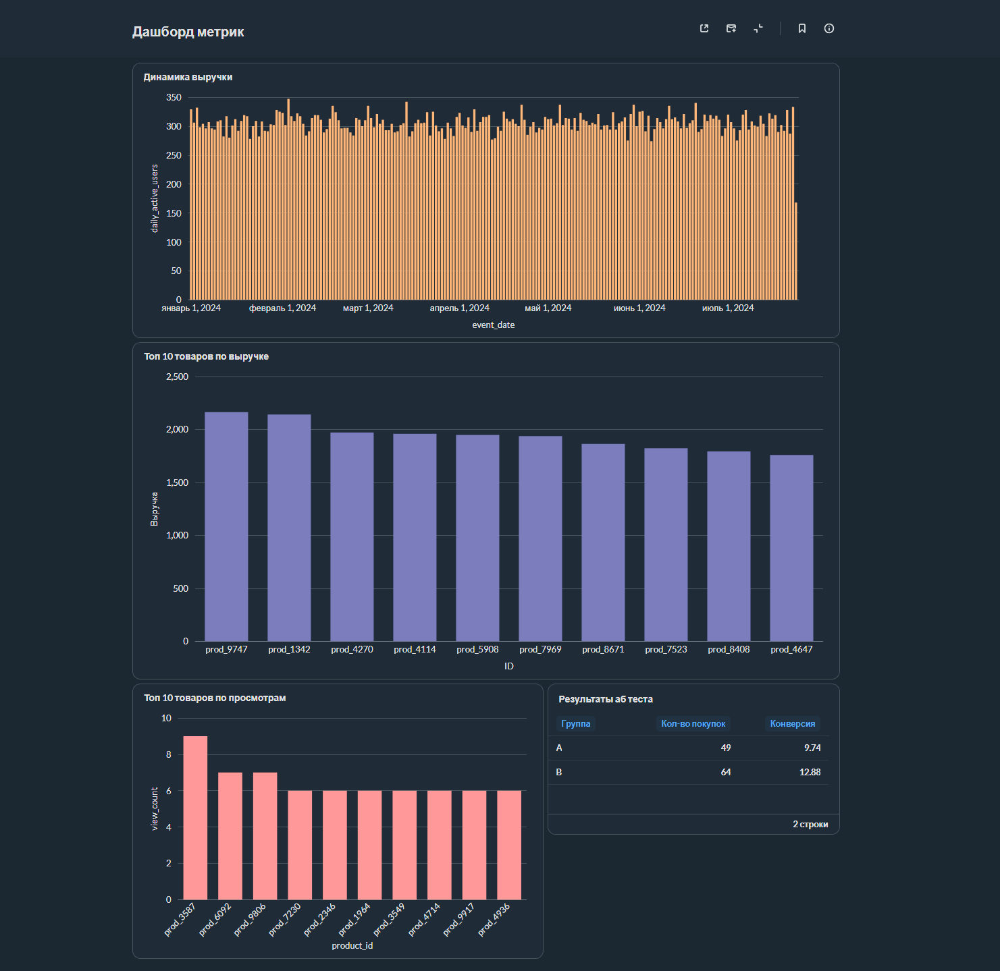

# E-commerce Analytics & A/B Testing

## О проекте
Учебный пет-проект по анализу данных интернет-магазина. Я взял готовый датасет с логами событий, написал SQL-запросы для расчета метрик, сделал скрипт на Python для симуляции A/B-теста и собрал результаты в дашборд в Metabase.

## Результат работы

## Стек технологий
PostgreSQL, Python (Pandas, SciPy), Metabase, Docker.

## Файлы в репозитории
* `sql_queries.sql` - SQL-запросы для метрик (динамика выручки, топ товаров, результаты A/B-теста).
* `ab_test.py` - Python-скрипт для симуляции A/B-теста и проверки статистической значимости.
* `metabase.db.mv.db` - файл базы Metabase с готовым дашбордом.
* `ecommerce_events.csv` - исходный датасет с логами.
* `requirements.txt` - нужные библиотеки Python для скрипта.

## Как посмотреть дашборд (помимо снимка экрана)
В репозитории лежит файл базы Metabase. Чтобы открыть дашборд, запустите контейнер через Docker:

Для Windows:
docker run -d -p 3000:3000 --name metabase -v "%cd%/metabase.db.mv.db:/metabase.db/metabase.db.mv.db" metabase/metabase

Для Mac или Linux:
docker run -d -p 3000:3000 --name metabase -v "$(pwd)/metabase.db.mv.db:/metabase.db/metabase.db.mv.db" metabase/metabase

После запуска откройте http://localhost:3000.
